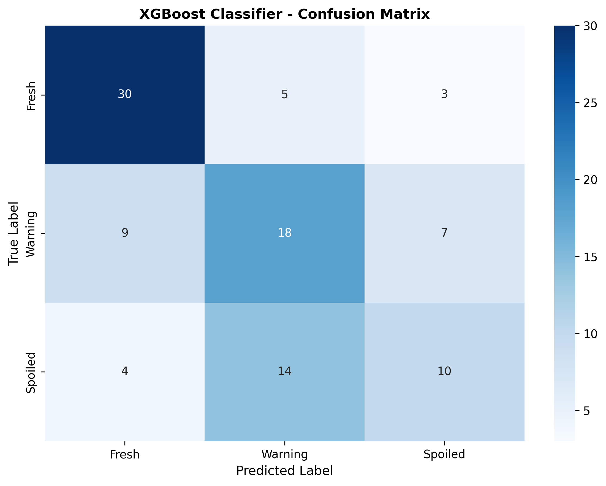
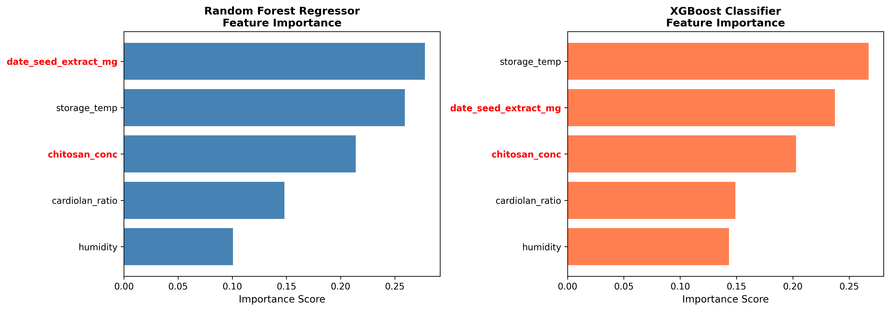
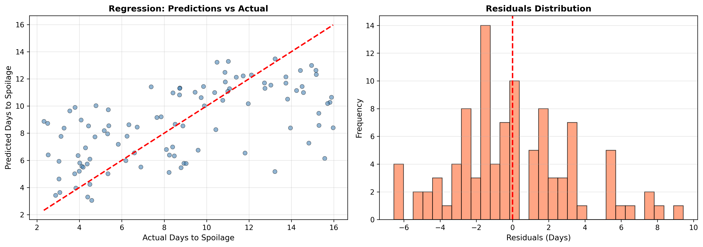

# Frutafina: Strawberry Spoilage Prediction

ML models (Random Forest, XGBoost) with a Flask API and a Streamlit app
to predict strawberry spoilage and shelf life.

## Files
- `frutafina.py`: model training, evaluation, and Flask API
- `streamlit_app.py`: interactive web interface
- `confusion_matrix.png`, `feature_importance.png`, `regression_residuals.png`: results

## Setup
pip install -r requirements.txt

## Run
streamlit run streamlit_app.py

## Results

